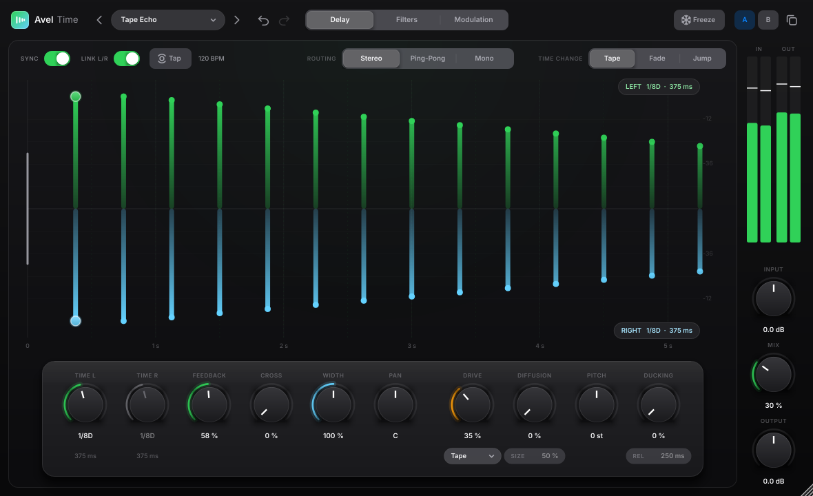

# Avel Time

Универсальный стерео-дилей из линейки Avel в духе FabFilter Timeless: два независимых канала, фильтры и сатурация внутри петли обратной связи, питч, диффузия, freeze, дакинг и модуляция.

## Три экрана
Переключаются сегментом вверху по центру.

**Delay**
- Над линией эхо левого канала, под линией правого. Высота столбика показывает громкость повтора. Первое эхо каждой стороны можно перетаскивать мышью, с Shift значение округляется до целых мс.
- **Sync**: время в нотах от 1/64 до 4/1, есть пунктирные (D) и триоли (T). **Link L/R**: правый канал повторяет левый. **Tap**: время задаётся ритмом нажатий, нужно не меньше двух.
- **Routing**: Stereo, Ping-Pong (эхо прыгает L → R → L), Mono.
- **Time Change**: как эхо реагирует на смену времени. Tape плавно тянет высоту как лента, Fade делает кроссфейд, Jump быстро переключает.
- **Ручки:**
  - Time L/R — время каждого канала.
  - Feedback — до 120 %. Выше 100 % начинается самовозбуждение, громкость держит мягкий лимитер в петле.
  - Cross — перекрёстная обратная связь между каналами.
  - Width, Pan — ширина и баланс эха.
  - Drive — сатурация Tape, Tube или Clip.
  - Diffusion и Size — размывают повторы в облако.
  - Pitch — сдвиг на каждом повторе, ±12 полутонов (shimmer, октава вниз).
  - Ducking и Rel — эхо приглушается, пока играет вход.

**Filters**
- Четыре фильтра внутри петли: Low/High Cut, Bell, Low/High Shelf, Band Pass, Notch. Каждый повтор проходит через них заново, поэтому эхо постепенно темнеет или сужается.
- Сплошная кривая показывает один проход, пунктирная — что останется после 4 повторов с учётом Feedback.
- Узлы перетаскиваются, колесо мыши меняет Q. Двойной клик добавляет фильтр или включает/выключает его, правый клик открывает меню типа.
- За кривыми идёт анализатор: тусклый — вход, светлый — эхо.

**Modulation**
- LFO 1 и LFO 2: формы Sine, Triangle, Saw, Square, S&H, Smooth Random. Rate в Гц или в нотах (Sync). Stereo сдвигает фазу правого канала.
- Envelope: огибающая входа, настраиваются Attack, Release и чувствительность.
- Шесть слотов «источник → цель → глубина». Цели: время (общее, L, R), Feedback, Cross, частоты фильтров 1–4, Drive, Diffusion, Pitch, Pan, Width, Mix.
- Масштаб при 100 %: время ±10 мс, фильтр ±4 октавы, питч ±12 полутонов.

**Сверху и справа**
- Пресеты, undo/redo, Freeze (петля держится бесконечно, новый вход не пишется), A/B со сравнением и копированием.
- Справа индикаторы уровня и ручки Input, Mix, Output. При Mix до 50 % сухой сигнал остаётся на полной громкости, так удобно ставить плагин прямо на дорожку.

Есть 20 заводских пресетов. Свои пресеты сохраняются в `Документы/Avel/Avel Time/Presets` как файлы `.xml`, их можно передавать.

## Сборка
- **macOS:** `bash build_mac.sh` собирает VST3, AU и Standalone и ставит плагин в `~/Library/Audio/Plug-Ins`. Нужны только Xcode Command Line Tools: CMake и JUCE 8.0.4 скачиваются автоматически. `bash make_installer_mac.sh` после этого делает `.pkg` в `dist/`.
- **Windows:** `cmake -S . -B build`, затем `cmake --build build --config Release --target AvelTime_VST3`. Установщик собирается Inno Setup по скрипту `packaging/windows/AvelTime.iss`.
- **GitHub Actions:** `.github/workflows/build.yml` собирает `.pkg` и `.exe` при каждом пуше в `main`. По тегу `v*` они публикуются в Releases.
- **Тесты:** `cmake -S . -B build -DAVEL_BUILD_TESTS=ON`, затем запустить `AvelTimeTest`. Проверяются точность времени, затухание, ping-pong, устойчивость при 120 %, freeze, питч, соответствие кривых фильтров, сохранение состояния, пресеты и нагрузка; снимки интерфейса сохраняются в `shots/`.

## Коды
Производитель `Avel`, код плагина `AvTm`, bundle ID `com.avel.time`, пакеты установщика `com.avel.time.vst3` / `com.avel.time.au`.

## Лицензии
Плагин построен на JUCE 8 (AGPLv3 или коммерческая лицензия JUCE). Шрифт Inter распространяется по SIL Open Font License (`Resources/Fonts`).
